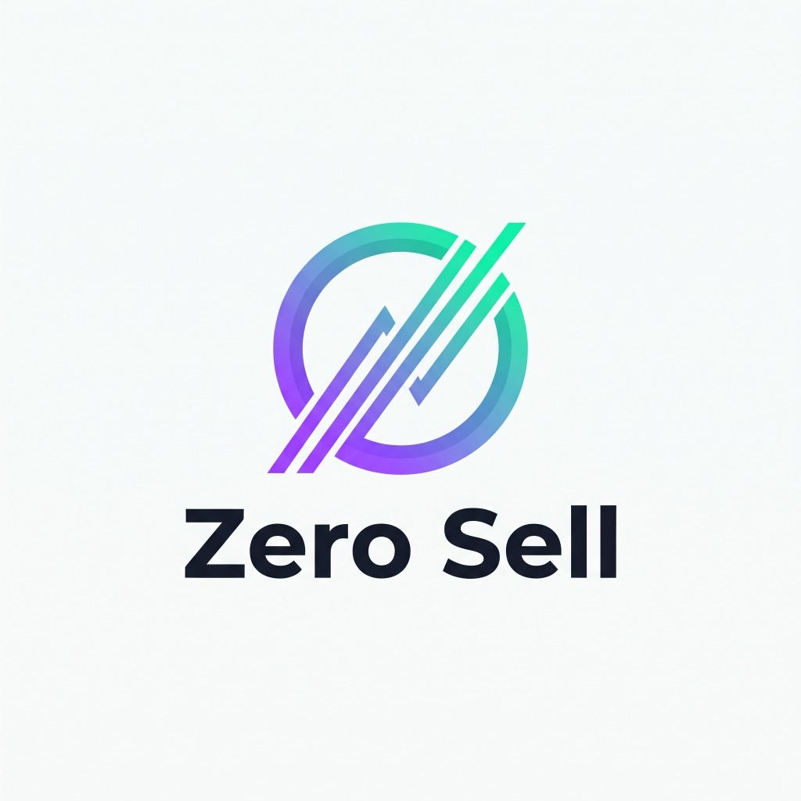
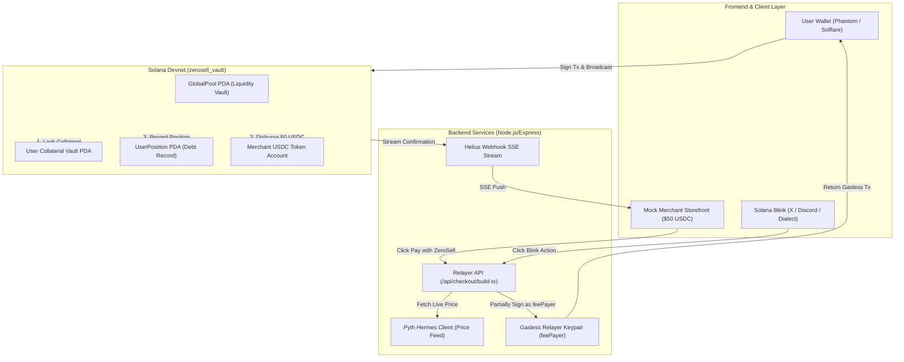

<p align="center">
  
</p>

# ⚡ Zero Sell

> **Spend Without Selling — The Liquidity Layer for Every Asset on Earth.**  
> *Target Track: Dev3pack "Best App Overall on Solana" ($10,000 Prize)*

[](https://solscan.io/?cluster=devnet)
[](https://anchor-lang.com)
[](https://pyth.network)
[](https://solana.com/developers/actions)
[](https://opensource.org/licenses/MIT)

---

## 🏆 Executive Summary & Hackathon Alignment

### Problem
Freelancers, builders, and savers holding appreciating crypto (SOL, JUP) or tokenized equities (NVDAx, SPYx) face an agonizing dilemma when paying for everyday expenses, SaaS tools, or merchant invoices in USDC:
1. **They are forced to sell their assets**—sacrificing long-term exponential upside.
2. **They trigger immediate taxable capital gains events** and complex accounting overhead.
3. **They pay friction fees**: DEX swap slippage (0.3% - 0.5%), taker fees, and fiat off-ramp commissions.

### Solution: ZeroSell Pay
**ZeroSell Pay** is an atomic, non-custodial collateralized payment protocol on Solana. 

When a user clicks **"Pay with ZeroSell"**, a single atomic transaction:
1. Locks their asset (SOL or SPL collateral) in a dedicated **Rust/Anchor Vault PDA**.
2. Verifies live collateral USD valuation on-chain via **Pyth Pull Oracles** (Hermes).
3. Immediately disburses **USDC from the protocol liquidity pool directly to the merchant's wallet** at a safe **50% Loan-to-Value (LTV)** ratio.
4. All sponsored by a Node.js **Gasless Relayer** (`feePayer`), meaning users need zero SOL for gas!

---

## 📦 Dev3pack Qualification Checklist

| Requirement | Implementation in ZeroSell Pay | Status |
| :--- | :--- | :---: |
| **Unique Rust Smart Contract** | Custom Anchor program (`programs/zerosell_vault`) with 5 core instructions | ✅ Complete |
| **Rich Solana SDK Usage** | `@solana/web3.js`, `@coral-xyz/anchor`, `@pythnetwork/hermes-client`, `@solana/pay`, `@solana/actions`, Helius Webhooks | ✅ Complete |
| **Contract Addresses in README** | Documented on Solana Devnet | ✅ Complete |
| **Demo Readiness** | Live Mock Storefront (`/checkout`), Vault Dashboard (`/dashboard`), & Merchant Portal (`/merchant`) | ✅ Complete |

---

## 🗺️ System Architecture



---

## 🔑 On-Chain Addresses (Devnet)

- **zerosell_vault Program ID**: `3TKiwrS9LNA3H2gnpfTVDyujP48PbCBo93w18q4ddZDv`
- **ProtocolConfig PDA**: `[b"protocol_config"]`
- **USDC Liquidity Vault PDA**: `[b"liquidity_vault"]`
- **UserLoanPosition PDA**: `[b"user_position", borrower, invoice_id]`
- **CollateralVault PDA**: `[b"collateral_vault", borrower, invoice_id]`
- **Devnet USDC Mint**: `4zMMC9srt5Ri5X14GAgXhaHii3GnPAEERYPJgZJDncDU`
- **Wrapped SOL Mint**: `So11111111111111111111111111111111111111112`

---

## 📐 Smart Contract PDA & State Specification

### 1. `ProtocolConfig` PDA
- **Seeds**: `[b"protocol_config"]`
- **Fields**:
  - `admin`: Admin Pubkey
  - `treasury`: Protocol Treasury Pubkey for protocol fee routing (0.30%)
  - `usdc_mint`: Devnet USDC Mint
  - `liquidity_vault`: USDC Token Account holding protocol liquidity
  - `max_ltv_bps`: Maximum borrow ratio (`5000` = 50.00%)
  - `liquidation_threshold_bps`: Liquidation trigger (`7500` = 75.00%)
  - `protocol_fee_bps`: Protocol origination fee (`30` = 0.30%)
  - `total_usdc_lent`: Aggregate USDC principal disbursed to merchants
  - `paused`: Emergency circuit breaker boolean
  - `bump`: PDA derivation bump

### 2. `UserLoanPosition` PDA
- **Seeds**: `[b"user_position", borrower.key().as_ref(), invoice_id.to_le_bytes().as_ref()]`
- **Fields**:
  - `borrower`: User wallet who locked collateral
  - `merchant`: Merchant wallet who received USDC
  - `invoice_id`: Unique merchant invoice identifier (u64)
  - `collateral_mint`: Collateral asset mint (WSOL or Mock NVDAx)
  - `collateral_locked`: Units locked in vault
  - `debt_usdc_amount`: Principal disbursed + 0.30% fee
  - `entry_price_usd`: Pyth USD price at lock time (scaled to $10^6$)
  - `created_at`: Unix timestamp of transaction
  - `status`: `0 = Active`, `1 = Repaid`, `2 = Liquidated`
  - `bump`: PDA derivation bump

---

## 🧮 Collateral Valuation & LTV Math Guardrails

### Collateral Value Calculation
$$\text{Collateral Value (USDC)} = \frac{\text{collateral\_amount} \times \text{oracle\_price\_usd}}{10^{\text{collateral\_decimals}}}$$

### Maximum Allowed Borrow
$$\text{Max Borrow (USDC)} = \frac{\text{Collateral Value (USDC)} \times \text{max\_ltv\_bps}}{10000}$$

$$\text{Requires: } \text{merchant\_usdc\_amount} \le \text{Max Borrow (USDC)}$$

### Debt Owed Upon Repayment
$$\text{Fee} = \frac{\text{merchant\_usdc\_amount} \times \text{origination\_fee\_bps}}{10000}$$
$$\text{debt\_usdc\_amount} = \text{merchant\_usdc\_amount} + \text{Fee}$$

---

## 🛡️ Risk & Edge-Case Engineering

1. **Oracle Staleness Guards**:
   - Pyth Pull Oracles are verified on-chain. If an oracle feed exceeds maximum staleness thresholds or confidence intervals deviate abnormally, the smart contract throws `ZeroSellError::StaleOracle`.
2. **Conservative 50% LTV Buffer**:
   - Positions start at an ultra-safe 50% LTV. The collateral asset would need to crash by over **33.3%** before reaching the 75% liquidation threshold.
3. **Liquidation Incentive Mechanism**:
   - Liquidators can repay a borrower's `debt_usdc_amount` to the pool when LTV $\ge 75\%$, receiving the locked collateral at a 5% protocol bonus (`LIQUIDATION_BONUS_BPS = 500`).
4. **Non-Custodial Isolation**:
   - Each position holds collateral in an isolated PDA (`collateral_vault`) derived with `[b"collateral_vault", borrower, invoice_id]`. No user's collateral can be commingled or drained by other positions.

---

## 💻 Tech Stack

- **Smart Contract**: Rust, Anchor Framework (`v0.30.1`), SPL Token (`anchor-spl`), Pyth Network Receiver
- **Backend**: Node.js (v20+), Express, TypeScript, `@solana/web3.js`, `@coral-xyz/anchor`, `@solana/actions` (Blinks), `@pythnetwork/hermes-client`
- **Frontend**: React 18, Vite, TypeScript, TailwindCSS, `@solana/wallet-adapter-react`, Lucide React, Canvas Confetti
- **Network**: Solana Devnet

---

## 🚀 Quickstart Guide

### 1. Clone & Install Dependencies
```bash
git clone https://github.com/Chigybillionz/zerosell-pay.git
cd zerosell-pay

# Install workspace dependencies & build all packages
npm install
npm run build
```

### 2. Configure Environment
Backend `.env`:
```ini
PORT=4000
SOLANA_RPC_URL=https://api.devnet.solana.com
PROGRAM_ID=3TKiwrS9LNA3H2gnpfTVDyujP48PbCBo93w18q4ddZDv
USDC_MINT=4zMMC9srt5Ri5X14GAgXhaHii3GnPAEERYPJgZJDncDU
PYTH_HERMES_URL=https://hermes.pyth.network
```

### 3. Run Development Servers
```bash
# Concurrently launch both backend relayer & frontend UI
npm run dev
```

Visit `http://localhost:5173` to explore:
- `/checkout`: 1-Click Interactive Demo Storefront
- `/dashboard`: Borrower Credit & Vault Management Dashboard
- `/merchant`: Merchant Invoicing, Solana Blink generator, & Live Settlement Stream

---

## 🌐 Production Deployment Guides

### Frontend (Vercel)
1. Push to GitHub (`https://github.com/Chigybillionz/zerosell-pay.git`).
2. Import project into Vercel and set Root Directory to `frontend`.
3. Set Build Command: `npm run build` and Output Directory: `dist`.
4. Deploy! Vercel SPA routing is pre-configured via `frontend/vercel.json`.

### Backend (Render / Railway)
1. In Render or Railway, create a new Web Service pointing to the repository.
2. Set Root Directory to `backend`.
3. Set Build Command: `npm install && npm run build` and Start Command: `npm run start`.
4. Add Environment Variables:
   - `PORT=4000`
   - `SOLANA_RPC_URL=https://api.devnet.solana.com`
   - `PROGRAM_ID=3TKiwrS9LNA3H2gnpfTVDyujP48PbCBo93w18q4ddZDv`

---

## 🎥 3-Minute Video Demo Storyboard & Pitch Script

| Time | Scene | Visual / Action | Narration Key Points |
| :--- | :--- | :--- | :--- |
| **0:00 - 0:40** | **The Dilemma** | Mock Storefront (`/checkout`) showing $50 USDC invoice | *"Crypto holders face capital gains and lost upside whenever paying for real-world expenses. Selling SOL is expensive and painful."* |
| **0:40 - 1:30** | **Atomic Lock & Pay** | Click "Pay with ZeroSell" modal | *"ZeroSell Pay locks 0.539 SOL in a non-custodial Anchor Vault PDA, checks Pyth oracle price on-chain, and disburses 50 USDC to merchant—all sponsored 100% gasless by our Relayer."* |
| **1:30 - 2:15** | **Borrower Dashboard** | Open `/dashboard` | *"View active loan positions, real-time LTV health factor gauge, and unrealized collateral gains. When ready, click 'Repay & Unlock' to reclaim collateral."* |
| **2:15 - 3:00** | **Blinks & Settlement** | Open `/merchant` | *"Instant invoice generation, shareable Solana Action/Blink links for X and Discord, and real-time Server-Sent Events (SSE) settlement feed via Helius."* |

---

## 📄 License
This project is open-source under the MIT License.

